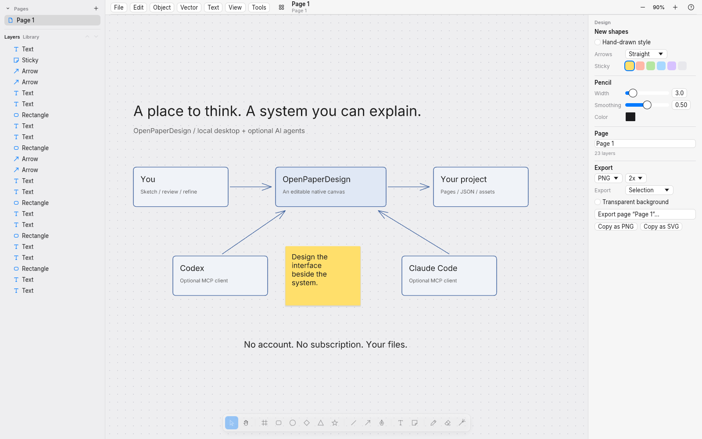

# OpenPaperDesign

A free, open-source canvas for ideas, diagrams, interfaces and visual work. Work on your own, or connect an AI agent over MCP.



Built on **paper-rs by [Michael Shimeles (Rasmic)](https://github.com/michaelshimeles)**, now developed as [Sketch](https://github.com/michaelshimeles/sketch). The core editor is his work. OpenPaperDesign adds agent-host integration, design methods and desktop packaging. This is an independent fork, not affiliated with Paper (paper.design).

The product images use the new UI/UX source snapshot from PR #9. They are development previews; they are not screenshots of an already released desktop package.

## Desktop preview

[Downloads and releases](https://github.com/arcitai/openpaperdesign/releases) · [Installation and platform status](docs/openpaperdesign/desktop.md)

The existing **v0.1.0 release is source code**, not an installer. Desktop packaging is being verified in the desktop packaging work. Do not substitute an upstream Sketch download for an OpenPaperDesign app.

| Platform | Current evidence |
| --- | --- |
| macOS, Apple Silicon | Integrated new-UI preview opens, edits, saves and reopens on Apple M4; ad-hoc signed, not notarized. Downloaded first launch remains unqualified. |
| Windows, x64 | Release build and ZIP packaging passed in CI; native desktop journey pending. |
| Linux, x64 | Release build, CLI smoke and tarball packaging passed in CI; native desktop journey pending. |

## What you can do

- Work through systems with editable shapes, text and bound arrows.
- Sketch with hand-drawn shapes, ink and sticky notes in six colours.
- Design screens with frames, auto layout, components, vectors and image fills.
- Keep projects locally as JSON pages and assets. Export PNG, SVG or PDF; import SVG and Excalidraw.
- Connect a compatible MCP client, including Codex or Claude Code, when you want agent help.

The native desktop app and the Codex plugin reuse the same editor, but have different host interfaces. The newer Codex Home/workspace UI is still developed separately in [PR #9](https://github.com/arcitai/openpaperdesign/pull/9). A desktop build does not imply that branch has been accepted or released. Avoid editing the same project simultaneously in the native app and the plugin; the plugin's checked writer path does not protect against external native writers.

## Why I built this

I wanted somewhere to sketch systems and design interfaces with an AI agent, without another paid design-tool subscription. Michael's paper-rs gave me a native, editable canvas to build on. I keep that foundation and add the integrations and methods I use in my own work.

## Build from source

Rust 1.95 or later and your platform's native build dependencies are required:

```sh
cargo build --release --locked --bin openpaperdesign --bin paper-rs-mcp
./target/release/openpaperdesign
```

The distribution entrypoint uses the platform’s local application-data folder (`~/Library/Application Support/OpenPaperDesign/projects` on macOS). Set `PAPER_RS_HOME` to choose another library. Existing upstream libraries are not moved. The original `paper-rs` command, editor, file formats and environment variables remain available. Platform details and the optional MCP bridge are in the [desktop guide](docs/openpaperdesign/desktop.md). The original [upstream README](docs/upstream-README.md) is retained for its detailed feature and command documentation.

## Agent integration

- [Native desktop MCP](docs/openpaperdesign/desktop.md#optional-ai-agents): connect an MCP client to the running app.
- [Codex plugin](docs/openpaperdesign/plugin-b2b.md): the separate, project-bound browser integration.
- [Design methods](plugin/openpaperdesign/skills/design/SKILL.md): portable direction and rendered review.

No account or hosted backend is required. There is no cloud sync or multiplayer service. The native app and project-bound plugin have distinct access contracts; setup instructions document those boundaries.

## Product page and provenance

The source for the [product page](site/README.md) is in `site/`. Its screenshots are rendered by the actual native app from the public, editable [product fixtures](design/product/fixtures). [Capture and asset provenance](site/assets-sources.json) records the source and hashes. Public launch at `openpaperdesign.arcitai.com` remains separate from local preview.

## Licences and credits

MIT OR Apache-2.0. Keep [LICENSE-MIT](LICENSE-MIT), [LICENSE-APACHE](LICENSE-APACHE), [THIRD_PARTY.md](THIRD_PARTY.md) and the bundled font notices with distributions. Upstream history and authorship are preserved. The product page's Geist font is also distributed under its bundled OFL notice.
