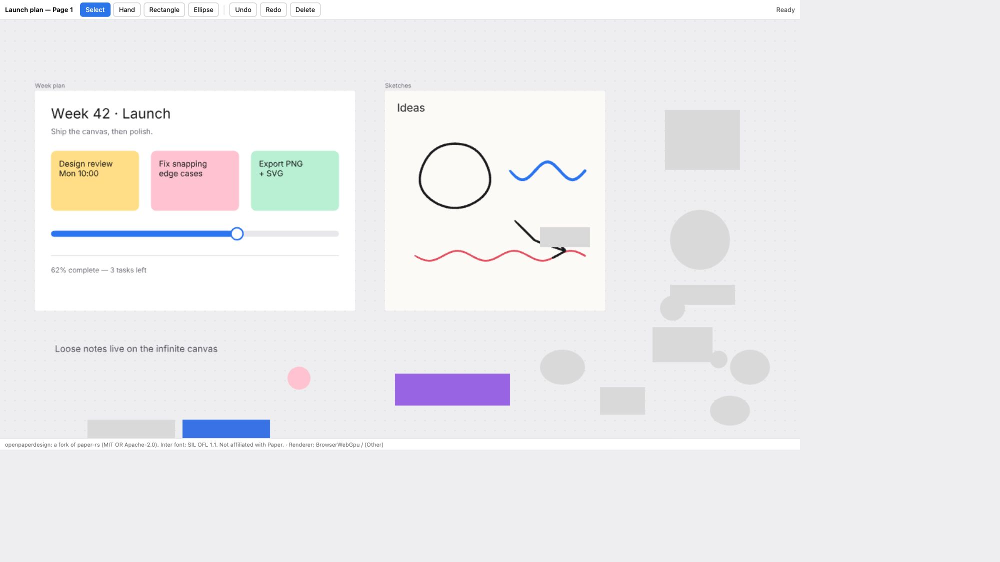

# B2b: the standalone `openpaperdesign` Codex plugin — 2026-10-12

Updated 2026-10-13: installed qualification on exact `0078487`; prior results retain their original provenance.

Scope: [issue #1](https://github.com/onlinesourdough/openpaperdesign/issues/1), slice B2b, on top
of B1 (`browser-edit-b1.md`) and B2a (`agent-edit-b2a.md`). It is a small local plugin. The
agent deliberately binds one design project in the user's workspace, edits it over MCP, and
opens the editable canvas in Codex's in-app browser on a loopback URL. No AIOS dependency, no
cloud, no telemetry. Not affiliated with Paper (paper.design).

Out of scope: MCP Apps / file entrypoints (the in-app browser at loopback is the editing
surface), plugin publishing, other hosts. The later sidebar home is described in the next section.

## Sidebar home (issue #6): source candidate, 2026-10-13

Not installed or qualified. [Issue #6](https://github.com/onlinesourdough/openpaperdesign/issues/6)
adds `openpaperdesign_home`, the Codex sidebar (global) entry, and its static MCP App view
`ui://openpaperdesign/home.html` (`text/html;profile=mcp-app`). The server now lists 34 tools
and one resource.

- **Home tool and view resource.** Both are answered before workspace admission. They read and
  change no context, binding, project, listener or file, and the tool refuses any argument.
  The exemption names exactly these two. Every other tool keeps per-call admission and
  retirement unchanged.
- **The view never calls the server's tools and stores nothing.**
  - Its actions (open an existing canvas, new canvas, current project) send a user message
    to the active chat with `ui/message`, only when the host advertises `message.text`.
    Otherwise they show the text to paste. A message grants nothing; the model runs the usual
    guarded steps.
  - It shows project details only from admitted `openpaperdesign_status` and `open_editor`
    results that the host delivers. Those two tools carry the view as a model-only result
    presentation.
  - It opens only the exact loopback editor URL, through `ui/open-link`. Codex's
    acknowledgement is not proof that the canvas loaded.
- **Native Codex project inventory is shown as not available in this build.** Codex 0.162.1's
  experimental app-server has `project/list` and `project/read`: an operator ran a read-only
  probe on 2026-10-13. Integration still needs the exact app-server handshake and proof that
  the packaged plugin can reach the CLI. A listed root is discovery, never write authority.

Issue #6 stays open until these are proven on a real host:
1. Native inventory and root selection.
2. Workspace authority for model calls in the global entry's own thread. The Mac global
   receipts carried only thread ids.
3. Delivery of model results to the view.
4. Where `ui/open-link` opens the loopback page.
5. An actual canvas load.

## Installed qualification (2026-10-13)

**PASS for exact `0078487e9f2bea191b8156172daa5cba6d1f17f9` on macOS**, using installed
`openpaperdesign@openpaperdesign-local` 0.1.0, fresh Codex 0.162.1 CLI app-server **model
turns**, and the actual Codex in-app browser. Independent R6 accepted this source with no
material findings (13 focused Rust checks and seven package checks). Installation for
qualification began at 2026-10-12 22:46 UTC while R6 was still running; qualification
completed at 23:05 UTC (2026-10-13 in Copenhagen). Distribution is source-only / local build,
with no packaged installer or public marketplace listing. See
[repository Releases](https://github.com/onlinesourdough/openpaperdesign/releases) for delivery status.

| Check | Observed result |
| --- | --- |
| Binary and discovery | Installed binary matched the exact Mac release; doctor passed, all 23 package files matched, four skills and 33 tools were discovered. |
| Mac checks | 85 distinct serve tests passed (28 library, 24 agent, eight launcher, eight context, 17 API), plus a separate five-test real-TCP context run. The browser bundle was inherited unchanged from `cffeec6`, not freshly rebuilt. |
| Selected workspace and worktree | Real model status/create/read/edit passed under workspace-write. The ordinary Git worktree fixture kept all 32 protected/sibling file hashes unchanged and created its design only inside the selected worktree. |
| Refusal and compatibility | Read-only creation refused with no design output. Direct app-server calls lacking metadata failed closed. A model status call under the unchanged inherited exact `disabled` profile passed. |
| Browser and agent | A CUA pointer move showed Saved. A stale agent `update_styles` call was refused; the two authoritative manifest/page hashes stayed unchanged. After a fresh read, an agent color edit preserved the moved position; browser reload preserved both. MCP `get_screenshot` returned a PNG. |
| Binding and restart | Missing/same-project binds and unforced switch/create guards behaved as expected. Forced switch closed the old port; a later old-tab save visibly failed as server unreachable without changing the saved page. Full MCP/app-server stop, new-process bind/read and a fresh WebGPU browser reopen preserved all 39 nodes; node 28 remained at (720, 566), 230 × 64, fill `#9b5de5`. Probe processes stopped and old ports closed. |

Installed binary SHA-256:
`69cfd77434f17c23c08cbe9b2c22d43151de02309431b69da6d1d24de059734d`.
Project-private receipts are under `.toolchain/operator-evidence/installed-0078487/`
(`installed-model-plugin-proof/qualification-summary.json`, `binary-install.json`, model
readbacks and preservation/reopen proofs); exact Mac checks are under
`.toolchain/operator-evidence/mac-0078487/`. Raw receipts, private paths and token URLs are
not distributed with these docs.

The initial managed-profile attempt inherited `approval_policy: never`; Codex blocked the
MCP call before the plugin. Successful managed tests used ephemeral `on-request` with
individually inspected, once-only approvals, without persistent policy or grant changes.
If the host reports that approval is required but forbidden, use an owner-authorized
per-call approval route or stop and report the host-policy limitation. Do not disable
protection or broaden grants to make the plugin work.

An unreferenced `project 2.json` copy matching the pre-test manifest appeared; its cause is
unknown and it was left untouched. The two authoritative files and document preservation
were verified separately; this is not a claim that every workspace byte stayed unchanged.



Observed after full process stop and reopen: Ready, WebGPU, the saved launch-plan canvas
and purple rectangle. This is the operator's unchanged screenshot, not a generated mockup.

## What is in it

- **`openpaperdesign-mcp`** (entrypoint `crates/openpaperdesign-serve/src/bin/openpaperdesign-mcp.rs`,
  shared implementation `src/launcher.rs` in that crate)
  is the plugin's MCP server, over stdio.
  - **Workspace:** the package uses `--codex-context`, pinning Codex's selected workspace
    from per-call metadata. Standalone `--workspace` or deliberate cwd is a separate mode.
    See the versioned contract below; process cwd is not package workspace authority.
  - **Tools:** upstream's design tools, behind B2a's bound-project host and policy, plus:
    - `bind_project {path}`: an existing paper-rs project (has `project.json`) inside the
      workspace. Symlinks are resolved before the inside-check, so links leading out are
      refused. A workspace that is the home folder or `/` is refused.
    - `create_project {name}`: makes `<workspace>/design/<name>/`. It refuses an existing
      folder and a `design/` that leads outside.
    - `open_editor`: returns `http://127.0.0.1:<port>/#token=<token>` for the in-app browser.
      The URL is never written to disk.
    - `openpaperdesign_status`: version, workspace, bound project, whether the editor is
      built in, plus workspace source, permission mode, state and refusal reason.
  - **Before a bind:** valid workspace/permission context is required, then editing tools require a deliberate project bind.
  - **One project per process:** binding again switches projects.
    - **Failed rebind:** the new project is opened and fully checked before the current one
      is touched (containment, `project.json`, page ids, page links). A failed bind leaves
      the current binding, its server, and its editor URL and token working, provided workspace/permission context remains valid.
    - **Rebinding the same project** changes nothing.
    - **In-flight work on a successful switch:** preparation does not reset layout state.
      The old binding closes admission and waits for its started writer/rollback under the
      shared MCP/browser write lock. Queued and late old work is refused without executing.
      Only then are the old page ids released and the new binding activated. Old HTTP
      sessions, routes and cloned server handles remain retired. Cancelling the bind's
      response waiter does not interrupt an already-started handoff.
    - **Unsaved browser edits:** once `open_editor` has handed out the URL, switching stops
      the server that browser tab saves to. Edits made through the tools are saved by each
      call, but the tab may hold an unsaved edit, which could no longer be saved. So the
      switch (`bind_project` or `create_project`) is refused with that explanation until it is
      called again with `force: true`. The skill tells the agent to ask the person first.
      The server doesn't know whether the tab actually has unsaved edits; the earlier claim
      that "changes are already saved" was an assumption and was removed.
    - **Exit:** when the launcher exits (the session ends), an open tab loses its server
      the same way, without a prompt.
  - **Serving:** the bound project is served by the B2a server, in the same process, on
    127.0.0.1 with a fresh 32-byte token. Tool calls go to that server's single host, with the
    same write lock, policy, atomic saves and revisions as its HTTP `/mcp`, so the browser and
    the agent edit the same document. The stdio client is one MCP session of that host, so
    B2a's stale-write check applies: a change to a page the person saved since the agent last
    read it is refused as a `conflict`, and nothing is written.
  - **`openpaperdesign-mcp doctor`** prints the setup as JSON (exit 0 only when the editor is
    built in and the platform is supported). `--version` prints the version.
- **The web bundle is compiled into the command.** `build.rs` embeds
  `target/openpaperdesign-web` (or `$OPD_WEB_BUNDLE_DIR`) when all six files exist. Otherwise
  the list is empty and `open_editor` says "build the web bundle first", without guessing a
  path at run time. Editing through the tools still works without it.
- **`plugin/openpaperdesign/`:**
  - `plugin.json`, the only manifest (see "Packaging" below): `$schema` agent-plugins 1.0.0,
    MIT OR Apache-2.0, repository onlinesourdough/openpaperdesign, version 0.1.0, and
    `extensions.com.openai` with `interface` and `onboardingSkill`;
  - `mcp.json`: one server, `{"type": "stdio", "command": "openpaperdesign-mcp", "args": ["--codex-context"]}`,
    with no `cwd` (see "Packaging");
  - `NOTICE.md`;
  - skills `openpaperdesign` (bind, edit, `open_editor`, in-app browser, limits), `setup`
    (build, install, `doctor`), and the ported `design` and `review-design`.
- **`.agents/plugins/marketplace.json`**: the local marketplace `openpaperdesign-local`,
  pointing at `./plugin/openpaperdesign`.

### Current-host workspace contract (2026-10-13)

This is experimental support for **Codex 0.162.1**, not a portable MCP workspace standard.
The server advertises `capabilities.experimental["codex/sandbox-state-meta"] = {}`.
Codex supplies `sandboxCwd` (a file URI) and `permissionProfile` in per-call `_meta` on real
model tool calls. rmcp exposes it as `RequestContext.meta`, separate from tool arguments.
The pinned [Codex call path](https://github.com/openai/codex/blob/092d3acd6bec3e3a14bdc7e7a2810ab628ab759d/codex-rs/core/src/mcp_tool_call.rs#L853)
and actual operator no-op model calls confirm delivery even when the MCP process cwd is
different. Direct app-server calls do not add this context. No client roots, workspace
interpolation, parent-process discovery or manual per-project overrides are used.

Accepted profiles are deliberately narrow, checked against the pinned
[profile types](https://github.com/openai/codex/blob/092d3acd6bec3e3a14bdc7e7a2810ab628ab759d/codex-rs/protocol/src/models.rs#L299)
and [permission semantics](https://github.com/openai/codex/blob/092d3acd6bec3e3a14bdc7e7a2810ab628ab759d/codex-rs/protocol/src/permissions.rs#L120):

- Exact `{"type":"disabled"}`: the host sandbox is disabled; plugin containment, identity,
  protected-path rules and lifecycle checks remain enforced. This is not a request to
  enable full access.
- `type: managed`, `network: restricted` or `enabled`, `file_system.type: restricted`, with
  exactly eight entries (order does not matter): special `root` read; one explicit absolute path
  write matching the selected workspace; special `slash_tmp` and `tmpdir` write; and
  `<write-path>/.git`, `.agents`, `.codex`, `.aws` read, each with
  `missing_path_behavior: skip`. Temporary grants never expand project scope.
  Both network strings are observed host values; neither changes the adapter's
  loopback-only listener or initiates outbound requests. Other/missing values refuse.

Read-only, absent, unknown, custom or ambiguous profiles refuse all editing/binding and
writable-browser access. Extra entries/fields, missing exclusions and alternative grant
shapes are unsupported. The four protected path names are refused in project paths,
including canonical aliases; protected entries must be absent or real directories,
except that root `.git` may also be an opaque regular file, as in a Git worktree. The
adapter never reads/parses that file or follows its gitdir pointer; a sibling repository
gains no authority. Symlinked protected entries remain unsupported. These are
also plugin-specific restrictions for the `disabled` variant, not claimed host exclusions.
The URI parser accepts normalized absolute UTF-8 local `file:///` or `file://localhost/`
paths, with strict percent decoding; remote hosts, dot segments, encoded separators,
query/fragment, NUL and invalid encodings refuse. Existing root/home/plugin-folder,
canonical containment, moved/replaced-directory and safe-creation checks remain.

The first valid writable context pins one canonical workspace and its device/inode.
Before that, invalid context stays unresolved and writes nothing. Every later tool call
must provide valid context for that same directory. Missing, changed, unsupported or
no-longer-writable context permanently invalidates the session: admission closes, the
started writer/rollback drains, queued/retained stdio/HTTP/browser calls are fenced, and
the listener stops. Cancellation cannot interrupt retirement. A later valid call cannot
revive it; use a fresh supported session. Valid same-project/failed project rebind behavior
is unchanged. Status reports source, permission mode, state and refusal reason.

This is conservative adapter admission, **not OS sandboxing**. Checks observe tool calls;
idle permission revocation is not detected instantly, and it does not protect a concurrent
native app/external writer. Standalone `--workspace <dir>` or deliberate cwd remains
separate; combining it with `--codex-context` refuses. A standalone doctor pass is a
binary/bundle check, not host context or installed-editing proof.

Historical evidence (2026-10-12/13): `0921280` installation/discovery passed with four
skills and 33 tools, but plugin-cache cwd made workspace status unusable and creation
correctly refused. Later no-op model diagnostics established the current metadata shapes;
they did not edit through this product. Synthetic adapter tests remain distinct from the
installed qualification above.

| Earlier implementation evidence | Result at that revision |
| --- | --- |
| Linux `e004da4` | 83 serve tests; the final protected-workspace guard was rechecked with 28 library + six context tests. The library also passed with the portable listener. Serve clippy/fmt/diff and seven package checks passed. Initial TCP EPERM was resolved by scoped loopback approval. |
| Intermediate Mac `e004da4` | Fresh release, 83 serve tests and five separate real-TCP context tests passed; inherited `cffeec6` bundle. Not installed or published. |
| Linux `0078487` worktree/network correction | 28 library + eight synthetic-context tests with real loopback, serve clippy/fmt/diff and seven package checks passed. Two new regressions first failed on `e004da4`; the corrected fixture preserved opaque pointer bytes and sibling files while editing selected `design/`. |

These runs did not repeat unchanged root/GPU/wasm/browser-bundle baselines. Their original
logs remain retained; exact Mac and installed results for `0078487` are recorded above.

### Packaging (corrected 2026-10-12)

The operator checked draft `1714a58` against the installed Codex plugin-creator 0.1.26
(`references/plugin-packages.md`). The corrections:
- **Fixed discovery:** skills come from the `skills/` folder and the MCP server from the root
  `mcp.json`. It names the server as `type: "stdio"`, command `openpaperdesign-mcp`,
  with no `cwd`. The original `args: []` relied on host process cwd, whose installed
  behavior was unverified at that review. The 092 installation later showed plugin-cache
  cwd and correctly refused creation. The current package uses `args: ["--codex-context"]`
  and the explicit contract above. `plugin.json` still has no top-level `skills`,
  `mcpServers`, `apps` or `interface`.
- **Short description:** `extensions.com.openai.interface.shortDescription` is at most 30
  characters. It is now "Agent + human design canvas" (27).
- **One manifest:** the `.codex-plugin/plugin.json` overlay was removed. Nothing showed that
  the local Codex needs it, and an `extensions.com.openai` object replaces the overlay
  entirely rather than merging with it. Two copies could only contradict each other.
  - **Intended:** per the packaging reference, Codex reads `plugin/openpaperdesign/plugin.json`
    (common fields at the top level, Codex presentation in `extensions.com.openai`) and
    discovers `skills/` and `mcp.json` itself.
  - **Later installed evidence:** on `0921280`, Codex discovered four skills and 33 tools
    without an overlay. That historical discovery check did not qualify editing/browser behavior.
- **Field limits:** the staged reference (`codex-plugin-packages-0.1.26.md`, checked by the
  B2b review) caps only `shortDescription` (30 characters). `defaultPrompt` and the icon
  fields have rules of their own but aren't set. No other caps apply to the fields set here.

### Ported design methods (AIOS #54)

The source-only handoff (AIOS `a14f2857`, v0.28.1, archive SHA-256 `c07f5553…`, MIT 2026
onlinesourdough) was verified: all 28 files matched their manifest hashes.

- **Ported:** `design` (skill, references, `create-handoff.mjs`, `paths.mjs`, `serve.mjs`)
  and `review-design` (skill, `audit.md`, `audit.py`), adapted host-neutral. AIOS names and
  links to AIOS-only skills became neutral wording, and the editable companion is now the
  openpaperdesign editor.
- **Left out:** the OpenPencil adapter (`openpencil-workbench`, the OpenPencil route of
  `create-handoff.mjs` and `test_openpencil.py`). It drives an external editor this plugin
  doesn't ship or test, and openpaperdesign is its own editable companion here.
- **Provenance:** each ported `SKILL.md` ends with a note, keeps its `LICENSE`, and is listed
  in `plugin/openpaperdesign/NOTICE.md`.
- **Tests:** ported to `plugin/tests/design/` (Python 3, standard library). They point at the
  plugin and drop the OpenPencil cases; the proof.json case is kept, and a preview-copy case
  replaces the mixed OpenPencil one. CI now runs them, which AIOS did not.

The replacement's local installed qualification now passes on `0078487`, including
discovery of these portable methods. AIOS #54 remains separately owned. Legacy removal
requires a published replacement plus installed readback. This record provides verified
local installation, not an assertion that legacy removal is complete.

## Install on a Mac (operator steps)

These follow the operator's installation contract for the local Codex CLI (operator notes,
2026-10-12): `codex plugin marketplace add <local-repo> --json` and
`codex plugin add openpaperdesign@openpaperdesign-local --json`. Installation and discovery
passed on `0921280`; its selected-workspace editing attempt failed closed. The corrected
`0078487` installed model/browser qualification passed as recorded above. These are
source-only / local-build steps; they do not provide a packaged installer or public
marketplace listing.

```sh
# 1. Build the browser editor and install the command (Rust 1.95 + wasm32 target,
#    wasm-bindgen CLI 0.2.129), from a checkout of this repository at the reviewed commit:
cd <checkout>
./scripts/build-web.sh
# With a shared CARGO_TARGET_DIR, point the build at the bundle just verified:
OPD_WEB_BUNDLE_DIR="$PWD/target/openpaperdesign-web" \
  cargo install --locked --path crates/openpaperdesign-serve --bin openpaperdesign-mcp
openpaperdesign-mcp --version       # openpaperdesign-mcp 0.1.0
openpaperdesign-mcp doctor          # exit 0, "browser_editor": "built in", no missing files
command -v openpaperdesign-mcp      # ~/.cargo/bin/openpaperdesign-mcp

# 2. Add the local marketplace and the plugin (existing plugins stay untouched):
codex plugin marketplace add <checkout> --json
codex plugin add openpaperdesign@openpaperdesign-local --json
```

For an existing 0.1.0 installation, the normal CLI refresh is
`codex plugin remove openpaperdesign@openpaperdesign-local --json`, then the `plugin add`
command above, using the reviewed checkout. This removes only this plugin's local cache;
never edit cached files. Package version remains 0.1.0. The qualification install matched
all 23 package files; verify your own installation rather than assuming a current desktop
chat has reloaded its tool catalog.

3. Start a fresh Codex session after the operator's normal plugin reload. The qualified
   surface was a fresh CLI app-server model session, not a reload of an existing desktop
   chat catalog. Verify installed MCP args `["--codex-context"]`, package files and binary
   identity. Observe the host-policy/once-only approval limitation above.
4. Use **actual model tool calls** in the selected task workspace, first with ordinary
   workspace-write permissions. Direct app-server `mcpServer/tool/call` lacks automatic
   context and is not an installed editing proof. Read back and record:
   - the plugin `openpaperdesign@openpaperdesign-local`, installed and enabled ("Agent + human
     design canvas");
   - its four skills: `openpaperdesign`, `setup`, `design`, `review-design`;
   - the MCP server `openpaperdesign`, started, with `bind_project`, `create_project`,
     `open_editor` and `openpaperdesign_status` among its tools;
   - `openpaperdesign_status`: `version` 0.1.0, intended canonical `workspace`,
     `workspace_source: codex/sandbox-state-meta`, `workspace_state: pinned`,
     `workspace_permission_mode: managed-workspace-write`, `workspace_usable: true`,
     and `browser_editor: built in`;
   - that the `PATH` Codex used found `~/.cargo/bin`;
   - that no file containing the token appears in the workspace or the Codex config.
5. Fixture (a task-owned synthetic project only), in that workspace:
   - `create_project` with the name "Fixture", giving `design/Fixture/`. Or bind an existing
     synthetic project with `bind_project design/<name>`;
   - a successful read of the target page, `get_tree_summary` with `nodeId` `"root"` and its
     `pageId`. The summary `bind_project`/`create_project` returns doesn't count; without
     the read the next change is refused as a `conflict`;
   - a `create_shape` call on that page; `design/<name>/pages/*.json` changes;
   - `open_editor`; open the URL in the in-app browser. The canvas shows the shape;
   - move it in the browser and wait for "Saved", then let the agent edit again (it reads
     first). Reload: both changes are there;
   - conflict: the agent reads, you move the shape and it saves, then the agent edits that
     page. The agent gets a `conflict` and nothing is written;
   - rebind: `bind_project design/<missing>` fails and the open tab still saves;
     `bind_project` to another project is refused (needs `force: true`, explains the loss)
     until forced;
   - shutdown: quitting the session stops the editor server (the tab can't save any more).

   Include a selected Git worktree under ordinary workspace-write, with its root `.git`
   kept opaque and sibling metadata unchanged. Also check one actual model status call
   under the operator's unchanged existing
   `disabled` profile: `workspace_permission_mode: host-sandbox-disabled`, same scope
   guards. This does not authorize changing permissions to make a test pass.
   Don't paste the token URL into reports.

## Tests and results (2026-10-12, implementation worker sandbox, offline, Rust 1.95.0, Node 26.8.1, Python 3)

| Check | Result |
|---|---|
| `tests/launcher.rs` (the real binary over stdio, rmcp child-process client) | 5 passed (details below) |
| `node --test plugin/tests/plugin.test.mjs` | 7 passed (after the packaging correction): plugin.json fields, no top-level `skills`/`mcpServers`/`apps`/`interface`, shortDescription ≤ 30; every `./` path exists inside its root; no `.codex-plugin` overlay; `mcp.json` has exactly one entry, explicit `type: "stdio"`, the command on PATH, no `cwd` and no token; skills' frontmatter and size; the marketplace path resolves (after links) to the plugin folder inside the repository; notices and licenses. On `1714a58`'s files, 2 fail (top-level `skills`, the overlay) |
| `plugin/tests/design` (`python3 -m unittest`) | 12 passed |
| `cargo install --locked --offline --path crates/openpaperdesign-serve --bin openpaperdesign-mcp --root <tmp>` (the setup skill's command, offline here) | installed; release binary 39,032,168 B; `--version` 0.1.0; `doctor`: `"browser_editor": "built in"`, no missing files |
| Full check list | `cargo fmt --all --check`; clippy 0 warnings on the new crates (host) and only upstream `atomic.rs:30` on wasm32; serve 10 unit + 5 agent + 3 launcher + 17, web 111, shader 2; Node 18 (`session.test.mjs`) + 6 (`plugin.test.mjs`); Python 12; wasm32 check; native build; headless 9/0/0; serial 162/0/0 (= baseline, no quota errors); root clippy 1 upstream warning; `cargo tree -p paper-rs -e features` unchanged; `git diff --check` clean |

The launcher tests:

- `bind_edit_and_open_the_editor_inside_the_workspace_only`:
  - the tools are listed and the refused ones aren't;
  - before a bind, editing and `open_editor` are refused;
  - an absolute outside path, `../`, a symlink out, a non-project folder and a missing folder
    are all refused, with the outside project untouched;
  - binding `design/Landing` works and `create_shape` changes its page file;
  - `open_editor` returns a 127.0.0.1 URL with a 64-hex token. On that port `/api/project`
    gives 200 with the token and 401 with a wrong one, and `/` gives 200 (the editor is built
    in here). No token-bearing file appears in the workspace;
  - `create_project` creates `design/New board` and switches to it, and refuses a duplicate.
    After `open_editor`, the switch is first refused without `force` (and nothing is
    created), then succeeds with it.
- `home_folder_workspace_and_escaping_design_folder_are_refused`.
- `embedded_bundle_list_matches_the_server_allowlist`.
- `a_failed_rebind_keeps_the_current_project_and_its_editor` (B2b additions): it binds A,
  edits it and opens the editor. Then forced binds to a project with an unsafe page id, a
  project with a symlinked page file, a folder without `project.json`, a symlink out of the
  workspace and a missing path all fail. After each one, A is still bound, its editor URL
  answers 200 with its token, and its tools work. No file in the workspace, the outside
  folder or the outside project changed. Rebinding A says "already bound". A switch to a
  valid B is refused without `force` (the message says the edits would be lost, and A still
  answers). With `force`, B is bound and A's server stops listening.
- `the_plugin_folder_is_not_a_workspace`: started in a folder that looks like the installed
  plugin, `create_project` is refused, nothing is created, and `workspace_usable` is false.

Rebased on the B2a review round 1 fixes (`a96b32c`, 2026-10-12). The launcher now passes its
session to the host (`Server::call_tool(session, …)`) and the skill tells the agent to read
again after a `conflict`. Re-run after the rebase (proportionate: serve crate, plugin files):
`cargo fmt --all --check`; clippy for serve and web, 0 warnings; serve 4 unit + 9 agent + 3
launcher + 17; `node --test plugin/tests/plugin.test.mjs`; Python design tests; native build;
`git diff --check`. The rows above are from the pre-rebase run; serial and headless are
inherited from it (no root-package file changed).

B2b additions (rebind safety, the `force` switch, `mcp.json` stdio without `cwd`, install
steps), 2026-10-12. Run: `cargo fmt --all --check`; serve clippy, 0 warnings; serve 4 unit +
9 agent + 5 launcher + 17; plugin tests plus the Node CI command, 27 passed; `git diff
--check`. On `aea6397`'s launcher (with the new tests copied in) 3 fail: after a failed
rebind nothing is bound, a switch after `open_editor` needs no force, and a project is
created inside the plugin folder.

Rebased on the B2a review round 2 fixes (`9c3ba69`, 2026-10-12). An MCP session must read a
page before it changes it, and the skill now says to read first. (At this rebase the
launcher's bind-time `get_basic_info` still counted as a read; since the B2b review round 2
fixes it doesn't, see below.) Inline SVG may not
contain `<image>`. Re-run after the rebase: serve 4 unit + 13 agent + 5 launcher + 17;
plugin tests plus the Node CI command; `cargo fmt --all --check`; serve clippy; `git diff
--check`.

### B2b review round 1 (on `b4d41e3`)

| Finding | Fix | Test |
| --- | --- | --- |
| 1. A moved workspace whose old path became a symlink: `create_project` wrote into the link's target | At start the launcher records the workspace's canonical path and (device, inode). Before every bind and create it re-checks: still a real directory, same canonical path and identity. `design/`, `design/<name>/` and `pages/` are made with `create_dir` (no final-symlink following); an existing `design/` must be a real folder. Everything made is verified before any file is written. Upstream `Store::create` isn't used for this. | `a_replaced_workspace_is_refused_not_followed` (the reviewer's sequence, plus a plain directory put back at the same path). It fails on `b4d41e3`, where the project lands in the replacement target. |
| 2. `audit.py`: a companion named `DESIGN.md` overrode a stale reviewed hash (false PASS) | Canonical hashes are checked on their own. Companion entries naming canonical evidence (`BRIEF.md`, `DESIGN.md`, `REVIEW.md`, `proof.json`, `HANDOFF.md`, any case, `./` forms) fail. A defect in the ported AIOS method, recorded in `NOTICE.md` as fixed on port. | `test_companion_entries_never_stand_in_for_canonical_evidence` (REVIEW.md and proof.json forms). It fails with `b4d41e3`'s `audit.py`. |
| 3. Stale `cwd: "."` in this record | Corrected. Intended packaging is separated from unproven installed behaviour. | — |
| 4. Read before write (B2a `9c3ba69`) | The skill says to read the target page before the first change (`get_tree_summary` root, `get_node_info`), not to rely on the bind summary. The launcher tests read first. | `the_stdio_session_must_read_before_it_writes`: after a browser-style save through the editor port, the stdio session's write is refused and the page is unchanged; after a read it lands. It verifies the wiring, so it also passes on `b4d41e3`, which already tracked sessions. |

Remaining limit: verifying and then writing is a check-then-use sequence. A file-system actor
racing between the check and the write isn't excluded (as with B1's documented check/use
race). Fully directory-relative creation would need `openat`-style calls, which the
standard library doesn't offer and which would mean a new dependency.

Checks (2026-10-12): `cargo fmt --all --check`; serve clippy, 0 warnings; serve 4 unit + 13
agent + 7 launcher + 17; plugin tests plus the Node CI command, 28 passed; Python design
tests, 13 passed; `git diff --check`.

Rebased on the B2a review round 3 fixes (`b730f4c`, 2026-10-12). Reads now count per page
and only when they succeed, and the page list is read via `get_basic_info`. The skill says
so. Its tests read the page they write.

B2b review round 2 (on `66a825f`), 2026-10-12:
- **Duplicate evidence:** in the audit, `proof.json` is parsed with duplicate keys rejected
  at any depth (FAIL), and repeated Markdown records fail rather than keeping one. That
  covers reviewed companions, snapshot entries, derived exports, and any field label used
  twice. `create-handoff.mjs` likewise refuses a REVIEW.md that repeats a companion record
  or a field. A duplicate key in its `proof.json` input isn't detectable with `JSON.parse`,
  but every snapshot it makes is checked by the audit, which fails on it. Tests:
  `test_duplicate_evidence_is_never_collapsed` (the reviewer's five cases, plus repeated
  `Result`) and `test_repeated_review_records_refuse_the_handoff`; both fail with
  `535df68`'s scripts (identical to `66a825f`'s).
- **Target-page read:** the summary returned by `bind_project`/`create_project` now runs in
  a one-off session, so it is not the agent's read. Its `next` text, the MCP instructions,
  the skill and the operator fixture all require a successful read of the target page
  (`get_tree_summary` root with its `pageId`) before the first change. The launcher tests
  assert that a change straight after binding is refused. Re-run: serve 4 unit + 18 agent + 7 launcher + 17;
plugin tests plus the Node CI command; Python design tests; fmt, serve clippy and
`git diff --check`.

### Lifecycle correction after final review round 3 (2026-10-12)

Exact `b846b8a` has operator Mac evidence for a built-in editor bundle, doctor, 65 serve
checks and the sequential actual-stdio same-id switch (Y child 300px). The bundle was
inherited from unchanged `cffeec6` web inputs, not freshly rebuilt. Round 3 still rejected
`b846b8a`: overlapping old HTTP calls could restore X's layout state into Y or save X with
incorrect geometry after an early reset. This replacement introduces the retirement
boundary described above. Its regression tests use the actual launcher and MCP handler,
authenticated HTTP/axum connection tasks, worker and disk commits with deterministic
test-only scheduling. Portable tests substitute an in-memory listener and an inert web
bundle; `OPD_LIFECYCLE_TCP=1` selects real loopback for the same unit regressions. The
separate `tests/launcher.rs` continues to drive the actual executable over stdio.

Linux implementation checks for this correction: 23 library tests, 24 agent tests, eight
actual-executable stdio launcher tests and 17 API tests passed. All six deterministic
lifecycle regressions also passed with real Linux loopback. Serve clippy (`--all-targets`),
format and diff checks passed. Initial socket attempts were blocked by the sandbox;
scoped loopback access was then approved and those tests ran. No root/GPU/wasm/plugin
baseline was repeated; their inputs are unchanged. The README addition only prepends a
fork/setup entry; the upstream text below it is preserved byte-for-byte.

At that lifecycle handoff, fresh independent review, Mac lifecycle and installed-plugin/IAB
proof were pending. Later `0921280` installation/discovery passed; workspace editing failed
closed as recorded above. The later exact `0078487` passed R6 source review and the
installed qualification at the start of this record; those results do not rewrite the
earlier revision's proof.

## Remaining limits

- The current desktop chat's tool-catalog reload was not verified; qualification used
  fresh CLI app-server model sessions and the actual Codex in-app browser.
- Support is the experimental Codex 0.162.1 contract and exact profiles above, not universal
  host support or OS sandboxing. Idle host permission changes are not detected instantly.
- Distribution is source-only / local build, with no packaged installer (signed or
  unsigned) or public marketplace listing. Other hosts, an MCP App panel and a remote Z13
  canvas are unqualified.
- No live GPU-loss or physical crash/power-loss test. Untested renderer and interaction
  surfaces in the B1/B2a records remain unqualified beyond the specific observations above.
- Concurrent native/external writers remain outside the guarantee; no multiplayer/cloud.
